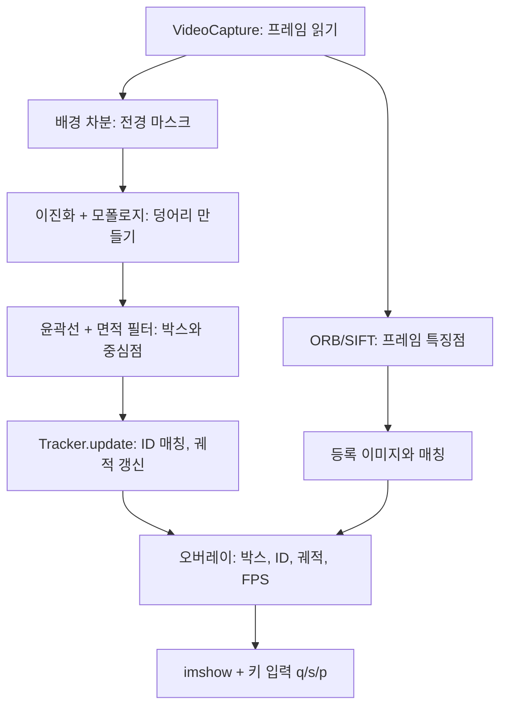
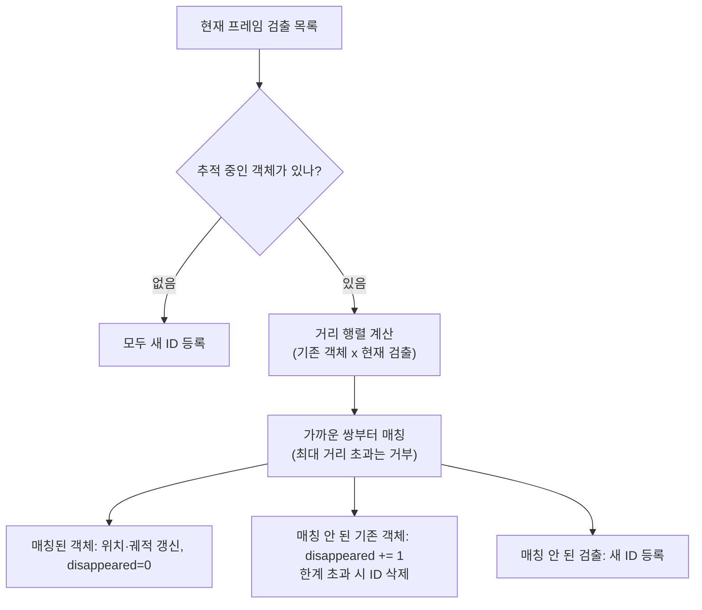

# A3-2 개념 정리 — 배경 차분, 거리 기반 추적, 특징점 매칭

대상: OpenCV로 사진 한 장을 다뤄 본 적은 있지만 영상 분석과 객체 추적은 처음인 학습자<br>
기준 과제: [A3-2 과제 안내(subject.md)](../subject.md)<br>
함께 볼 문서: [단계별 실습 가이드(WALKTHROUGH.md)](WALKTHROUGH.md)

이 문서는 완성 코드를 주지 않습니다. 대신 **영상에서 움직이는 것을 찾고, 번호를 붙여 따라가고, 등록한 물체를 다시 알아보는 과정**의 원리를 설명합니다. 그리고 이 방법들이 왜 겹침·가림·조명 변화에서 무너지는지 숫자로 이해하도록 돕습니다. 실제 작업 순서는 [WALKTHROUGH.md](WALKTHROUGH.md)를 따라가고, 막힐 때 이 문서의 해당 절로 돌아오면 됩니다.

## 읽는 순서

| 순서 | 배울 내용 | 이걸 알면 할 수 있는 일 |
| --- | --- | --- |
| 1 | 동영상과 프레임 루프 | 웹캠/파일을 읽고 FPS 표시, `q`/`s`/`p` 키 처리 |
| 2 | 프레임 차분 | 두 프레임의 차이로 움직임 찾기 |
| 3 | 배경 모델링과 학습률 | MOG2나 이동 평균으로 배경을 학습하고 학습률 효과 설명 |
| 4 | 이진화와 모폴로지 | 점 잡음을 지우고 사람을 한 덩어리로 만들기 |
| 5 | 윤곽선, 바운딩 박스, 중심점 | 덩어리마다 박스와 중심 좌표 구하기 |
| 6 | 거리 기반 추적 | `Tracker` 클래스로 ID 부여·유지·삭제, 궤적 그리기 |
| 7 | 위치만으로는 구분할 수 없는 이유 | 겹침에서 ID Switch가 생기는 원리 설명 |
| 8 | 특징점과 기술자 (ORB, SIFT) | 등록 이미지에서 특징점 추출 |
| 9 | 특징점 매칭 | 매 프레임 매칭 후 "TARGET DETECTED" 판정, 매칭률 측정 |
| 10 | 사람이 설계한 특징의 한계 | 회전·가림에 취약한 이유 설명 |
| 11 | 추적 성능 측정 | ID Switch, 추적 실패, 가림 구간을 기준대로 세기 |
| 12 | 딥러닝이 필요한 이유 | 보고서 6번 질문에 자신의 데이터로 답하기 |
| 13 | 보너스 개념 | Hungarian, 침입 구역, IoU, 칼만 필터 |

1~6이 필수 애플리케이션의 뼈대이고, 8~9가 재인식 기능, 7·10~12가 보고서의 이론적 배경입니다.

전체 처리 흐름은 다음과 같습니다.



---

## 1. 동영상과 프레임 루프

### 직관

동영상은 넘기는 그림책(플립북)입니다. 1초에 30장 정도의 사진(프레임)을 빠르게 보여 주면 움직이는 것처럼 보입니다. 그래서 영상 분석은 결국 **사진 한 장을 처리하는 코드를 매 프레임 반복**하는 것입니다. 배열로 보면 컬러 영상은 `(T, H, W, 3)`, 즉 이미지 배열에 시간 축 `T`가 하나 더 붙은 것입니다.

### 기본 루프

```python
cap = cv2.VideoCapture(0)            # 0: 기본 웹캠, 또는 "videos/cross.mp4"
while True:
    ok, frame = cap.read()           # ok가 False면 영상 끝 또는 카메라 오류
    if not ok:
        break
    # ... 프레임 처리 ...
    key = cv2.waitKey(1) & 0xFF
cap.release()
cv2.destroyAllWindows()
```

- `cap.isOpened()`로 열렸는지 먼저 확인합니다.
- 파일의 원래 FPS는 `cap.get(cv2.CAP_PROP_FPS)`, 현재 프레임 번호는 `cap.get(cv2.CAP_PROP_POS_FRAMES)`로 얻습니다. 프레임 번호를 화면에 띄워 두면 11절의 측정이 쉬워집니다(권장).

### FPS 계산

여기서 FPS는 "내 프로그램이 1초에 몇 프레임을 처리하는가"입니다.

$$\text{FPS} = \frac{1}{t_{\text{현재}} - t_{\text{이전}}}$$

시각은 `time.perf_counter()`로 잽니다. 프레임마다 값이 출렁이므로 지수 이동 평균으로 부드럽게 보여 주면 읽기 쉽습니다.

$$\text{FPS}_{\text{표시}} \leftarrow 0.9 \times \text{FPS}_{\text{표시}} + 0.1 \times \text{FPS}_{\text{이번}}$$

손 계산: 이번 프레임 처리에 0.04초가 걸렸다면 $1 / 0.04 = 25$ FPS입니다. 표시값이 30이었다면 $0.9 \times 30 + 0.1 \times 25 = 29.5$로 갱신됩니다.

### 키 입력: 종료, 저장, 일시정지

| 키 | 동작 | 구현 요령 |
| --- | --- | --- |
| `q` | 종료 | 루프 탈출 후 `release`, `destroyAllWindows` |
| `s` | 현재 프레임 저장 | 오버레이가 그려진 프레임을 시각 포함 파일명으로 `imwrite` |
| `p` | 일시정지/재개 | 불리언 상태를 토글하고, 정지 중에는 `read()`를 건너뛰되 `waitKey`는 계속 호출 |

정지 중에도 `waitKey`를 불러야 창이 응답하고 `p`, `q`를 다시 받을 수 있습니다.

### 흔한 오해

- **"`waitKey(1)`이면 영상이 원래 속도로 재생된다"** — 아닙니다. 처리 시간 + 1ms마다 다음 프레임을 읽으므로, 처리가 빠르면 파일이 빨리 감기처럼 재생되고 느리면 느려집니다. 분석에는 문제가 없지만 "FPS 표시값"과 "파일 FPS"를 혼동하지 않습니다.

---

## 2. 프레임 차분 (absdiff)

### 직관

틀린 그림 찾기처럼 두 장을 겹쳐 보고 다른 곳만 표시하면, 움직인 곳이 드러납니다.

### 정의

$$D(x, y) = \lvert I_t(x, y) - I_{t-1}(x, y) \rvert, \qquad M(x, y) = \begin{cases} 255 & D(x, y) > T \\ 0 & \text{그 외} \end{cases}$$

`cv2.absdiff(a, b)`는 `uint8`에서도 음수 넘침 없이 절댓값 차이를 계산합니다. (NumPy로 `a - b`를 하면 `uint8`이 넘쳐 엉뚱한 값이 됩니다.)

### 손 계산

| 픽셀 | 이전 프레임 | 현재 프레임 | 차이 | $T = 25$ 판정 |
| --- | --- | --- | --- | --- |
| 벽 | 120 | 123 | 3 | 배경 |
| 사람이 들어온 곳 | 120 | 60 | 60 | 전경 |
| 사람이 떠난 곳 | 60 | 120 | 60 | 전경 |

**바로 앞 프레임과 비교하면 문제가 두 가지 생깁니다.** 첫째, 사람이 "떠난 자리"도 전경으로 나타나 잔상이 생깁니다. 둘째, 사람이 멈추면 두 프레임이 같아져 사라집니다. 그래서 비교 대상을 "직전 프레임"이 아니라 **"사람이 없는 배경"**으로 바꾸는 것이 다음 절의 배경 모델링입니다.

---

## 3. 배경 모델링과 학습률

### 직관

매일 같은 교실 사진을 보다 보면 "원래 모습"이 머릿속에 그려집니다. 새로 들어온 사람은 그 기억과 다르니 눈에 띕니다. 그런데 커튼을 바꿔 달면 처음에는 낯설다가 며칠 지나면 원래 모습으로 받아들입니다. **기억을 얼마나 빨리 고쳐 쓰는가**가 학습률입니다.

### 이동 평균 배경

$$B_t = (1 - \alpha) B_{t-1} + \alpha I_t$$

$\alpha$(학습률)가 크면 최근 프레임을 많이 반영하고, 작으면 오래된 배경을 오래 기억합니다. OpenCV에서는 `cv2.accumulateWeighted(frame_float, background_float, alpha)`로 구현할 수 있고, 이후 `absdiff(현재, 배경)`으로 전경을 구합니다. (`absdiff`로 직접 구현하는 방식도 과제에서 허용됩니다.)

### 손 계산: 조명이 갑자기 밝아질 때

배경 픽셀이 100이었는데 불이 켜져 200이 되었고, 판정 임계값은 30이라고 합시다. $n$프레임 뒤 남은 차이는

$$\lvert I - B_n \rvert = (1 - \alpha)^n \times 100$$

입니다. 이 값이 30 미만이 되어야 "배경"으로 돌아옵니다.

| $\alpha$ | 계산 | 필요한 프레임 | 30fps 기준 |
| --- | --- | --- | --- |
| 0.5 | $0.5^2 \times 100 = 25$ | 2 | 약 0.07초 |
| 0.1 | $0.9^{12} \times 100 \approx 28$ | 12 | 약 0.4초 |
| 0.01 | $0.99^{120} \times 100 \approx 30$ | 약 120 | 약 4초 |

학습률이 작으면 조명이 바뀐 뒤 **약 4초 동안 화면 전체가 전경**으로 잡혀 거대한 가짜 객체가 생깁니다.

### 반대편: 사람이 멈춰 설 때

같은 식이 정지한 사람에게도 적용됩니다. $\alpha = 0.5$이면 사람이 멈추고 2~3프레임 만에 **배경으로 흡수되어 사라집니다.** $\alpha = 0.01$이면 4초 정도 버팁니다.

| 학습률 | 느린 변화(해 지는 조명, 흔들리는 나무) | 빠른 변화(전등 스위치) | 정지한 객체 |
| --- | --- | --- | --- |
| 작음 | 따라가지 못해 잔상·오검출 | 오랫동안 화면 전체 오검출 | 오래 유지됨 (좋음) |
| 큼 | 잘 따라감 | 빨리 회복 | 금방 사라짐 (나쁨) |

이것이 보고서 3번의 "느린 변화와 빠른 변화의 트레이드오프"입니다. 어떤 값을 골라도 한쪽은 포기해야 합니다.

### MOG2: 픽셀마다 여러 개의 배경을 기억

이동 평균은 픽셀마다 배경 값을 하나만 기억합니다. 하지만 흔들리는 나뭇잎 자리는 "잎(초록)"일 때도 "하늘(파랑)"일 때도 모두 배경입니다. **MOG2(Mixture of Gaussians)**는 픽셀마다 가우시안 분포 여러 개를 두어 "이 픽셀에서 흔히 나오는 값들"을 기억하고, 그 어느 분포에도 잘 맞지 않는 값을 전경으로 판정합니다.

```python
subtractor = cv2.createBackgroundSubtractorMOG2(history=500, varThreshold=16, detectShadows=True)
fg_mask = subtractor.apply(frame, learningRate=0.01)
```

| 인자 | 의미 |
| --- | --- |
| `history` | 배경을 기억하는 프레임 수. 자동 학습률은 대략 이 값에 반비례 |
| `varThreshold` | 분포에서 얼마나 벗어나야 전경인지. 키우면 덜 민감 |
| `detectShadows` | 그림자를 따로 표시(마스크 값 127). 전경은 255, 배경은 0 |
| `learningRate` (apply) | `-1` 자동, `0` 배경 갱신 안 함, `1` 매 프레임 새로 학습. 0~1 사이 값으로 직접 지정 가능 |

과제는 학습률을 **최소 3가지 값**으로 바꿔 관찰하도록 요구합니다. 예를 들어 0.001, 0.01, 0.1(필요하면 자동 `-1`도 비교)처럼 10배씩 다른 값을 고르면 차이가 잘 보입니다.

### 그림자 문제

사람 발밑의 그림자는 배경보다 어두워졌을 뿐인데도 "배경과 다르다"로 판정되어 사람 덩어리에 붙습니다. MOG2는 "밝기만 줄고 색 비율은 비슷한 픽셀"을 그림자로 표시(127)합니다. 마스크를 `cv2.threshold(mask, 200, 255, cv2.THRESH_BINARY)`로 이진화하면 그림자(127)를 버릴 수 있습니다. 완벽하지는 않으며, 진한 그림자는 여전히 전경으로 남습니다.

---

## 4. 이진화와 모폴로지

### 직관

전경 마스크는 보통 지저분합니다. 여기저기 튀는 하얀 점(노이즈)이 있고, 사람 몸 안에는 배경과 옷 색이 비슷해 생긴 구멍이 있습니다. 모폴로지 연산은 **지우개(침식)**와 **붓(팽창)**으로 이를 정리합니다.

### 기본 연산 (구조 요소 = 작은 모양 도장)

| 연산 | 규칙 | 효과 |
| --- | --- | --- |
| 침식(erode) | 도장 안이 **모두** 흰색일 때만 흰색 유지 | 얇은 것과 작은 점이 사라지고 덩어리가 줄어듦 |
| 팽창(dilate) | 도장 안에 흰색이 **하나라도** 있으면 흰색 | 덩어리가 커지고 작은 구멍이 메워짐 |
| 열림(open) | 침식 → 팽창 | 작은 점 잡음 제거, 큰 덩어리 크기는 대체로 유지 |
| 닫힘(close) | 팽창 → 침식 | 덩어리 안의 구멍·틈 메움, 크기는 대체로 유지 |

```python
kernel = cv2.getStructuringElement(cv2.MORPH_ELLIPSE, (5, 5))
mask = cv2.morphologyEx(mask, cv2.MORPH_OPEN, kernel)
mask = cv2.morphologyEx(mask, cv2.MORPH_CLOSE, kernel)
```

### 손 계산 (1차원, 폭 3짜리 도장)

**열림**: 입력 `0 0 1 0 0 1 1 0 1 1 1 0`

- 침식: 세 칸이 모두 1인 곳은 9번 칸뿐 → `0 0 0 0 0 0 0 0 0 1 0 0`
- 팽창: 9번 주변이 1로 → `0 0 0 0 0 0 0 0 1 1 1 0`

외톨이 점(2번)은 사라지고 폭 3짜리 덩어리는 원래대로 돌아왔습니다. 그런데 폭 2짜리 덩어리(5~6번)도 사라졌습니다. **도장이 객체보다 크면 진짜 객체도 지워집니다.** 커널 크기는 "지우고 싶은 잡음보다 크고, 지키고 싶은 객체보다 작게" 정합니다.

**닫힘**: 입력 `0 0 1 1 1 0 1 1 1 0 0` (가운데 구멍)

- 팽창: `0 1 1 1 1 1 1 1 1 1 0`
- 침식: `0 0 1 1 1 1 1 1 1 0 0`

구멍(5번)은 메워지고 전체 범위(2~8번)는 그대로입니다.

### 과제와의 연결

기능 요구 2의 "모폴로지 연산(열림, 닫힘)으로 노이즈를 제거하고 객체를 덩어리로 만든다"입니다. 닫힘을 너무 세게 하면 가까이 걷는 **두 사람이 한 덩어리로 붙어** 7절의 문제가 더 일찍 생깁니다. 이 또한 보고서에 적을 만한 관찰입니다.

---

## 5. 윤곽선, 바운딩 박스, 중심점

### 정의

| 함수 | 결과 | 쓰임 |
| --- | --- | --- |
| `cv2.findContours(mask, cv2.RETR_EXTERNAL, cv2.CHAIN_APPROX_SIMPLE)` | 덩어리별 외곽선 목록 (4.x는 반환값 2개) | 객체 후보 |
| `cv2.contourArea(c)` | 면적 | 너무 작은 움직임 무시 |
| `cv2.boundingRect(c)` | `(x, y, w, h)` | 박스 그리기, IoU 계산 |
| `cv2.moments(c)` | 모멘트 | 정확한 무게중심 |

중심점은 박스 중앙으로 간단히 구하거나

$$c_x = x + \frac{w}{2}, \qquad c_y = y + \frac{h}{2}$$

모멘트로 덩어리의 실제 무게중심을 구합니다.

$$c_x = \frac{m_{10}}{m_{00}}, \qquad c_y = \frac{m_{01}}{m_{00}}$$

($m_{00}$은 면적이므로 0이면 나눗셈 오류가 납니다. 면적 필터를 먼저 하면 피할 수 있습니다.)

손 계산: 박스가 `(x=100, y=50, w=40, h=120)`이면 중심은 $(100 + 20,\ 50 + 60) = (120, 110)$입니다.

### 면적 임계값 감각

640x480 영상에서 사람 한 명은 대략 수천~수만 픽셀² 면적입니다. 임계값을 너무 낮추면 나뭇잎·노이즈가 객체가 되고, 너무 높이면 멀리 있는 작은 사람을 놓칩니다. 해상도가 바뀌면 같은 값이 다른 의미가 되므로 "화면 면적의 몇 %"로 정하는 것도 방법입니다(권장).

---

## 6. 거리 기반 추적 (Tracker 클래스)

### 직관

운동장 사진을 1초 간격으로 두 장 찍었다고 합시다. 두 번째 사진에서 "철수"를 찾을 때 가장 자연스러운 추측은 **"첫 사진의 철수 자리와 가장 가까운 사람"**입니다. 1초 사이에 사람이 멀리 순간이동하지 않으니까요. 이것이 중심점 거리 기반 추적(centroid tracking)입니다.

### Tracker가 관리하는 상태

| 상태 | 자료형 예 | 의미 |
| --- | --- | --- |
| `next_id` | `int` | 다음에 새로 줄 ID |
| `objects` | `{id: (cx, cy)}` | 현재 추적 중인 객체의 마지막 위치 |
| `disappeared` | `{id: int}` | 연속으로 매칭되지 못한 프레임 수 |
| `tracks` | `{id: deque[(cx, cy)]}` | 이동 경로 (궤적 그리기용) |

### 한 프레임의 update 과정



과제 기능 요구 4의 다섯 항목(거리 계산, 가장 가까운 것끼리 매칭, 오래 안 보이면 삭제, 새 객체에 새 ID, 경로 저장·표시)이 그대로 이 그림의 상자들입니다.

### 유클리드 거리와 거리 행렬

$$d(p, q) = \sqrt{(p_x - q_x)^2 + (p_y - q_y)^2}$$

기존 객체가 $m$개, 현재 검출이 $n$개이면 $m \times n$ 거리 행렬을 만듭니다. NumPy 브로드캐스팅을 쓰면 반복문 없이 계산할 수 있습니다: `prev[:, None, :] - curr[None, :, :]`의 모양이 `(m, n, 2)`가 됩니다.

### 손 계산: 정상적인 매칭

이전: ID1 (100, 100), ID2 (300, 100). 현재 검출: a (110, 105), b (290, 98).

| | a (110, 105) | b (290, 98) |
| --- | --- | --- |
| ID1 (100, 100) | $\sqrt{10^2 + 5^2} \approx 11.2$ | $\sqrt{190^2 + 2^2} \approx 190.0$ |
| ID2 (300, 100) | $\sqrt{190^2 + 5^2} \approx 190.1$ | $\sqrt{10^2 + 2^2} \approx 10.2$ |

**그리디(탐욕) 매칭**: 전체에서 가장 작은 값부터 고릅니다. 10.2 → ID2=b, 남은 것 중 11.2 → ID1=a. 정답입니다.

### 꼭 필요한 두 개의 임계값

| 임계값 | 역할 | 너무 작으면 | 너무 크면 |
| --- | --- | --- | --- |
| 최대 매칭 거리 | 이보다 먼 쌍은 같은 객체로 보지 않음 | 빨리 움직이면 새 ID가 생김 | 멀리 있는 다른 객체와 잘못 이어짐 |
| 최대 소실 프레임 | 이만큼 연속으로 안 보이면 ID 삭제 | 잠깐 가려져도 ID가 바뀜 | 떠난 객체의 ID가 남아 엉뚱한 객체에 붙음 |

### 궤적

매칭될 때마다 `tracks[id]`에 중심점을 추가하고, `cv2.line`으로 연속한 점들을 이어 그립니다. `collections.deque(maxlen=N)`을 쓰면 최근 N개만 자동으로 유지되어 오래된 꼬리가 화면을 덮지 않습니다.

---

## 7. 위치만으로는 구분할 수 없는 이유

### 손 계산: 엇갈려 지나갈 때의 ID Switch

ID1은 (190, 100)에서 오른쪽으로, ID2는 (210, 100)에서 왼쪽으로 프레임당 15픽셀씩 걷습니다. 다음 프레임의 실제 위치는 ID1 → (205, 100), ID2 → (195, 100)이고, 검출 결과는 이름 없이 a (205, 100), b (195, 100)으로만 들어옵니다.

| | a (205, 100) | b (195, 100) |
| --- | --- | --- |
| ID1 (190, 100) | 15 | **5** |
| ID2 (210, 100) | **5** | 15 |

가장 가까운 쌍은 ID1=b, ID2=a입니다. 그런데 b는 실제로 ID2였던 사람입니다. **두 사람의 ID가 서로 바뀝니다.** 계산은 규칙대로 정확히 했는데도 틀렸습니다. 문제는 계산이 아니라 **입력에 "누가 누구인지" 구분할 정보가 위치밖에 없다**는 데 있습니다.

### 더 나쁜 경우: 덩어리 합쳐짐

두 사람이 겹치면 배경 차분 마스크에서 **한 덩어리**가 됩니다. 검출이 1개뿐이니 한 ID는 매칭되지 못해 `disappeared`가 올라가고, 다시 갈라질 때 어느 쪽이 어느 ID인지는 다시 거리로만 정해집니다.

### 규칙을 더하면?

| 추가 규칙 | 해결되는 상황 | 새로 생기는 문제 |
| --- | --- | --- |
| 최대 거리 줄이기 | 먼 객체와의 잘못된 연결 | 빠른 객체가 새 ID를 받음. 겹침은 여전히 가까움 |
| 이동 방향(속도) 고려 | 일정한 속도로 엇갈리는 경우 | 겹친 동안 멈추거나 방향을 바꾸면 실패 |
| 박스 크기·색 히스토그램 비교 | 체형·옷 색이 다른 경우 | 비슷한 옷, 조명 변화, 부분 가림에서 실패 |

규칙마다 예외가 생기고, 예외를 위한 규칙이 또 필요해집니다. 보고서 4번은 이 경험을 직접 시도한 기록으로 쓰는 것입니다. 결론은 **"위치만으로는 객체를 구분할 수 없다"**입니다. 구분하려면 **객체의 외형(appearance)**에 대한 정보가 필요합니다.

---

## 8. 특징점과 기술자 (ORB, SIFT)

### 직관

친구 얼굴 사진을 찾을 때 "왼쪽 눈썹 끝, 입꼬리, 점 위치" 같은 **눈에 띄는 지점**을 봅니다. 그리고 각 지점을 "주변이 이렇게 생겼다"는 짧은 설명으로 기억합니다. 지점이 **특징점(keypoint)**, 설명이 **기술자(descriptor)**입니다.

- 좋은 특징점은 **모서리(corner)**처럼 어느 방향으로 움직여도 모양이 변하는 곳입니다. 흰 벽(어디나 같음)이나 긴 직선(선 방향으로는 같음)은 나쁜 특징점입니다.

### ORB와 SIFT 비교

| 항목 | ORB | SIFT |
| --- | --- | --- |
| 특징점 찾기 | FAST 코너 + 이미지 피라미드(크기 변화 대응) | DoG(가우시안 차이) 극값, 여러 스케일 |
| 방향 | 밝기 중심(intensity centroid)으로 방향 계산 | 주변 그래디언트 방향 히스토그램의 최댓값 |
| 기술자 | 256비트 이진 문자열 (32바이트) | 128차원 실수 벡터 |
| 거리 | 해밍 거리 (`cv2.NORM_HAMMING`) | 유클리드 거리 (`cv2.NORM_L2`) |
| 속도 | 빠름, 실시간에 유리 | 느림, 더 정확한 편 |
| 생성 | `cv2.ORB_create(nfeatures=500)` | `cv2.SIFT_create()` |

과제 문서는 SIFT 사용 시 `opencv-contrib-python`이 필요하다고 안내합니다. 참고로 OpenCV 4.4.0 이후에는 SIFT가 기본 패키지로 옮겨져 `opencv-python`에서도 `cv2.SIFT_create`가 있는 경우가 많습니다. 설치된 버전에서 `hasattr(cv2, "SIFT_create")`로 확인하고, 없을 때만 contrib 패키지로 바꿉니다(기본 패키지와 contrib를 동시에 설치하지 않습니다). ORB는 기본 패키지로 충분합니다.

```python
orb = cv2.ORB_create(nfeatures=1000)
kp, des = orb.detectAndCompute(gray, None)   # kp: 특징점 목록, des: (N, 32) uint8 또는 None
```

### 해밍 거리 손 계산

8비트로 줄인 예: `10110010`과 `10010110`

```text
  10110010
^ 10010110
= 00100100  → 1인 비트 2개 → 해밍 거리 2
```

두 기술자가 다른 비트 수가 적을수록 비슷한 지점입니다. ORB의 실제 기술자는 256비트이므로 거리는 0~256입니다.

---

## 9. 특징점 매칭

### 흐름

1. 등록 이미지(추적하고 싶은 물체 1장)에서 특징점·기술자를 **한 번만** 계산해 둡니다.
2. 매 프레임 그레이스케일에서 특징점·기술자를 계산합니다.
3. 두 기술자 집합을 매칭합니다.
4. 좋은 매칭이 충분히 많으면 "TARGET DETECTED"를 표시합니다.

### 매처와 Lowe의 비율 검사

`cv2.BFMatcher`는 모든 쌍의 거리를 비교하는 전수 매처입니다.

- `crossCheck=True` + `match()`: A의 최선이 B이고 B의 최선도 A일 때만 남깁니다.
- `crossCheck=False` + `knnMatch(k=2)`: 각 특징점의 1등, 2등 후보를 받아 **비율 검사**를 합니다. (`crossCheck=True`와 `knnMatch(k=2)`는 함께 쓰지 않습니다.)

$$\text{좋은 매칭} \iff d_1 < r \times d_2 \qquad (r \approx 0.7 \sim 0.8)$$

| 1등 거리 $d_1$ | 2등 거리 $d_2$ | 비율 | $r = 0.75$ 판정 |
| --- | --- | --- | --- |
| 20 | 60 | 0.33 | 채택: 1등이 확실히 낫다 |
| 40 | 45 | 0.89 | 거부: 비슷한 후보가 둘, 반복 무늬일 가능성 |

### "TARGET DETECTED" 판정 규칙(설계 예시)

- 가장 단순한 규칙: 좋은 매칭 수 $\ge N$ (예: 15~30). 값은 실험으로 정합니다.
- 더 엄격한 규칙(권장): 좋은 매칭 점들로 `cv2.findHomography(src, dst, cv2.RANSAC, 5.0)`를 구해 **인라이어 수**(기하학적으로 일관된 매칭 수)가 $N$ 이상일 때만 인정합니다. 우연히 맞은 매칭이 걸러져 오탐이 줄고, 호모그래피로 물체 위치에 사각형을 그릴 수도 있습니다.

참고로 과제 문서의 최종 결과물 절은 "Target Found", 기능 요구 절과 결과 예시는 "TARGET DETECTED"라고 씁니다. 기능 요구와 예시에 맞춰 "TARGET DETECTED"를 표시하면 무난합니다.

### 매칭률 정의

보고서 2번 표는 "추출된 특징점 수 / 매칭된 특징점 수 / 매칭률"을 요구합니다. 과제가 매칭률 식을 정하지 않았으므로, 예를 들어 다음처럼 정의하고 보고서에 **정의를 명시**합니다(권장).

$$\text{매칭률} = \frac{\text{좋은 매칭 수}}{\text{등록 이미지에서 추출된 특징점 수}} \times 100\%$$

손 계산: 등록 이미지 특징점 500개, 정면 프레임에서 좋은 매칭 120개 → 24%. 60도 회전에서 좋은 매칭 30개 → 6%.

### 흔한 실수

- 프레임에 특징점이 하나도 없으면 `des`가 `None`이라 매칭에서 에러가 납니다. 매칭 전에 검사합니다.
- `knnMatch` 결과 중 후보가 1개뿐인 항목이 섞일 수 있어 `m, n = pair` 언패킹이 실패할 수 있습니다. 길이를 확인합니다.
- SIFT 기술자에 `NORM_HAMMING`을 쓰거나 ORB에 `NORM_L2`를 쓰면 의미 없는 거리가 나옵니다.

---

## 10. 사람이 설계한 특징(Hand-crafted Feature)의 한계

### 회전

ORB와 SIFT는 **화면 안에서 도는 회전(in-plane)**에는 방향을 계산해 어느 정도 대응합니다. 그러나 물체를 **앞뒤로 기울이는 회전(out-of-plane)**은 모양 자체를 찌그러뜨립니다(정사각형이 사다리꼴이 됨). 기술자는 "주변 작은 패치가 이렇게 생겼다"를 기록한 것이라, 패치가 찌그러지면 다른 기술자가 됩니다. 30도에서 60도로 갈수록 매칭 수가 급격히 줄어드는 이유입니다. 실험할 때 어떤 회전인지 보고서에 구분해 적습니다.

### 가림

특징점은 물체 표면 곳곳에 흩어져 있습니다. 50%를 가리면 대략 그만큼의 특징점이 사라지고, 가린 물체(손 등)의 모서리에서 엉뚱한 특징점이 새로 생겨 잘못된 매칭이 늘어납니다. 좋은 매칭 수가 판정 임계값 $N$ 아래로 떨어지면 미검출이 됩니다.

### 조명과 흐림

FAST 코너와 BRIEF 비트는 "이웃 픽셀 간 밝기 비교"에 기반합니다. 대비가 줄거나(어두움), 움직임 블러가 생기면 비교 결과가 바뀌어 특징점이 사라지거나 기술자가 달라집니다.

### "학습되지 않은 특징"의 일반화 문제

ORB와 SIFT의 규칙(어디를 코너로 볼지, 어떤 픽셀 쌍을 비교할지)은 사람이 정했고 데이터에 따라 바뀌지 않습니다. 새로운 변형(심한 기울기, 가림, 반사)이 나와도 규칙은 그대로이므로 대응할 방법이 없습니다. 반면 학습된 특징은 그런 변형이 담긴 데이터를 보고 "변형이 있어도 같은 물체"라는 표현을 스스로 만듭니다. 이것이 보고서 5번의 논지입니다.

---

## 11. 추적 성능 측정

### 측정 기준 (subject.md 정의 그대로)

| 지표 | 정의 |
| --- | --- |
| ID Switch | 겹침 이후 **5프레임 이상** 다른 ID로 유지되는 경우 |
| 추적 실패 | 대상이 화면에 있으나 **10프레임 이상** 미검출 또는 ID 미부여 |
| 가림(occlusion) 구간 | **50% 이상** 가려진 경우 추적 실패에서 제외하고 비고란에 기록 |

"5프레임 이상"이라는 조건은 1~2프레임만 깜빡 바뀌었다가 돌아오는 경우를 ID Switch로 세지 않기 위한 것입니다.

### 측정 프로토콜

- 조건별 20~30초 영상에서 보고서 표의 테스트 횟수(단일 객체 이동 10, 두 객체 겹침 10, 객체 일시 정지 5, 조명 변화 5)만큼 **이벤트**를 관찰합니다. 예: "두 객체 겹침 10회" = 두 사람이 엇갈리는 장면 10번.
- 기록 템플릿 컬럼: 영상명 - 조건 - 프레임 범위 - ID Switch 수 - 실패 수 - 관찰 메모.
- 측정은 수동입니다. 화면에 프레임 번호를 표시하고 `p`로 멈춰 가며 세면 정확해집니다.

```text
영상명,조건,프레임 범위,ID Switch 수,실패 수,관찰 메모
cross_01.mp4,두 객체 겹침,120-185,1,0,겹친 뒤 ID1/ID2 교환이 40프레임 유지
```

### 실패율 계산

$$\text{ID Switch 비율} = \frac{\text{ID Switch가 발생한 이벤트 수}}{\text{테스트 횟수}} \times 100\%$$

손 계산: 두 객체 겹침 10회 중 ID Switch 4회, 추적 실패 1회 → ID Switch 비율 40%, 추적 실패율 10%. 집계 방식(이벤트당 0/1로 셀지, 총 횟수를 셀지)을 보고서에 명시합니다(권장).

### 영상 준비

- 필수: "두 객체 겹침" 시나리오 20~30초 영상 최소 1개.
- 권장: "조명 급변", "정지/재등장" 시나리오 각 1개.
- 웹캠 직접 촬영 또는 PETS, MOT Challenge 같은 공개 데이터셋. 보고서에 영상명, 조건 라벨, 측정 방법을 적습니다.

---

## 12. 딥러닝이 필요한 이유

보고서 6번은 세 질문에 **자신의 측정 결과를 근거로** 답합니다. 아래는 생각의 방향일 뿐 정답이 아닙니다.

| 질문 | 고전 방법의 한계(이번 과제에서 관찰할 것) | 학습 기반 가설 |
| --- | --- | --- |
| 객체의 외형을 학습한다면 겹침 문제가 해결될까? | 위치만 써서 엇갈릴 때 ID Switch | 사람마다 외형 특징 벡터(re-identification)를 학습하면 위치가 겹쳐도 "누구인지" 비교 가능. 단, 옷이 같거나 완전히 가려지면 여전히 어려움 |
| 다양한 변형을 학습한다면 특징점 매칭이 개선될까? | 60도 회전, 50% 가림에서 매칭률 급락 | 회전·가림이 담긴 데이터로 학습한 특징은 변형에도 비슷한 표현을 유지 |
| 환경 변화를 학습한다면 배경 모델링이 강건해질까? | 학습률 트레이드오프, 조명 급변 오검출 | "사람/차 같은 객체"를 직접 인식하면 조명 변화 자체는 전경이 아님 |

과제에서 YOLO, SSD, R-CNN, OpenCV `dnn` 모듈, MediaPipe는 사용 금지이므로 이 부분은 실험이 아니라 **경험에 근거한 가설**로 씁니다.

---

## 13. 보너스 개념

### 13-1. Hungarian Algorithm (보너스 1)

그리디는 "지금 가장 가까운 쌍"부터 확정하므로 전체 합이 최소가 아닐 수 있습니다.

| | x | y |
| --- | --- | --- |
| A | 10 | 12 |
| B | 11 | 40 |

- 그리디: A-x(10) 확정 → B는 y(40)만 남음 → 합 50
- 최적: A-y(12) + B-x(11) → 합 23

Hungarian 알고리즘은 할당 문제(각 행에 열 하나씩, 합 최소)를 정확히 풉니다. 손으로 따라가 봅니다.

1. **행 축소**: 각 행에서 그 행의 최솟값을 뺍니다. `[[0, 2], [0, 29]]`
2. **열 축소**: 각 열에서 그 열의 최솟값을 뺍니다. 1열 최솟값 2 → `[[0, 0], [0, 27]]`
3. **0 덮기**: 모든 0을 덮는 최소 직선 수를 구합니다. 0행과 0열 두 줄로 덮이므로 줄 수 = $n$ = 2 → 최적 할당 존재.
4. **할당**: 0이 하나뿐인 B행은 x열, 그러면 A행은 y열. 원래 비용 12 + 11 = 23.

줄 수가 $n$보다 적으면 "덮이지 않은 원소 중 최솟값"을 덮이지 않은 원소에서 빼고 두 줄이 교차하는 원소에 더한 뒤 3번으로 돌아갑니다. 행과 열 수가 다르면 큰 값으로 채운 가짜 행/열을 더해 정사각 행렬로 만듭니다. scipy(`linear_sum_assignment`) 없이 NumPy만으로 구현해야 하며, 결과 검증용으로 작은 행렬에서 모든 순열을 다 시도하는 완전 탐색과 비교하면 좋습니다(권장).

### 13-2. 침입 감지 구역 (보너스 2)

- `cv2.setMouseCallback(창이름, 함수)`로 마우스 이벤트(`EVENT_LBUTTONDOWN`, `EVENT_LBUTTONUP` 등)를 받아 사각형 두 꼭짓점을 저장합니다.
- 중심점 $(c_x, c_y)$가 구역 안인지: $x_1 \le c_x \le x_2$ 그리고 $y_1 \le c_y \le y_2$.
- 같은 ID가 구역에 머무는 동안 매 프레임 로그가 쌓이지 않도록 "들어온 순간"만 기록하는 상태 관리가 필요합니다.

### 13-3. IoU 기반 매칭 (보너스 3)

$$\text{IoU} = \frac{\text{교집합 면적}}{\text{합집합 면적}} = \frac{\lvert A \cap B \rvert}{\lvert A \rvert + \lvert B \rvert - \lvert A \cap B \rvert}$$

손 계산: A = (0, 0)~(100, 100), B = (50, 50)~(150, 150)이면 교집합 50x50 = 2500, 합집합 10000 + 10000 - 2500 = 17500, IoU = 2500 / 17500 ≈ 0.143.

IoU는 "클수록 같은 객체"이므로 거리 행렬 대신 $1 - \text{IoU}$를 비용으로 쓰면 같은 매칭 코드를 재사용할 수 있습니다. 빠르게 움직여 이전 박스와 겹치지 않으면 IoU가 0이 되어 매칭이 끊긴다는 단점이 있습니다. 비교 지표는 ID Switch 횟수와 **추적 유지율**(예: 대상이 화면에 있는 프레임 중 올바른 ID로 추적된 프레임 비율. 정의를 보고서에 명시)입니다.

### 13-4. 칼만 필터 (보너스 4)

**직관**: 공을 눈으로 따라갈 때 "지금 속도라면 다음엔 저기 있겠다"고 예측하고, 실제로 보이면 예측을 고칩니다. 칼만 필터는 이 **예측(predict) → 보정(correct)** 반복을 수식으로 한 것입니다.

등속 모델의 상태와 행렬:

$$\mathbf{s} = \begin{bmatrix} x \\ y \\ v_x \\ v_y \end{bmatrix}, \qquad F = \begin{bmatrix} 1 & 0 & 1 & 0 \\ 0 & 1 & 0 & 1 \\ 0 & 0 & 1 & 0 \\ 0 & 0 & 0 & 1 \end{bmatrix}, \qquad H = \begin{bmatrix} 1 & 0 & 0 & 0 \\ 0 & 1 & 0 & 0 \end{bmatrix}$$

$F$는 "다음 위치 = 현재 위치 + 속도", $H$는 "관측되는 것은 위치뿐"이라는 뜻입니다. `cv2.KalmanFilter(4, 2)`로 만들고 `transitionMatrix`, `measurementMatrix`, 노이즈 공분산(`processNoiseCov`, `measurementNoiseCov`)을 `float32`로 지정한 뒤, 매 프레임 `predict()`로 예측하고 매칭된 중심점으로 `correct()`합니다.

7절의 엇갈림 예시에 적용하면: ID1의 속도 +15, ID2의 속도 -15를 알고 있으므로 예측 위치가 ID1 → 205, ID2 → 195입니다. 이 **예측 위치**와 검출 a(205), b(195)의 거리를 재면 ID1=a, ID2=b로 올바르게 매칭됩니다. 하지만 겹친 동안 멈추거나 방향을 바꾸면 예측이 틀려 다시 실패합니다. 적용 전/후 ID Switch 비율을 비교해 이 효과와 한계를 보고합니다.

---

## 복습 질문

1. 프레임 차분(직전 프레임과 비교)으로는 멈춰 선 사람을 감지하지 못하는 이유는?
<details><summary>답</summary>

멈춘 동안 연속한 두 프레임의 해당 픽셀 값이 거의 같아 차이가 임계값을 넘지 못하기 때문입니다. 비교 대상을 "배경 모델"로 바꿔야 합니다.
</details>

2. 이동 평균 배경에서 $\alpha = 0.1$일 때, 배경과 현재 값의 차이 100이 30 미만으로 줄려면 대략 몇 프레임이 필요한가?
<details><summary>답</summary>

$0.9^n \times 100 < 30$을 풀면 $n \ge 12$입니다. $0.9^{12} \approx 0.28$.
</details>

3. MOG2 마스크에서 값 127은 무엇이고, 객체 검출 전에 어떻게 처리하나?
<details><summary>답</summary>

`detectShadows=True`일 때 그림자로 판정된 픽셀입니다. 200 같은 값으로 이진화해 그림자를 배경으로 버릴 수 있습니다.
</details>

4. 열림과 닫힘의 순서와 각각의 용도는?
<details><summary>답</summary>

열림 = 침식 후 팽창, 작은 점 잡음 제거. 닫힘 = 팽창 후 침식, 덩어리 안 구멍과 틈 메우기.
</details>

5. 7절의 엇갈림 예시에서 그리디 매칭이 틀린 이유는 계산 실수인가?
<details><summary>답</summary>

아닙니다. 규칙(가장 가까운 것끼리)대로 정확히 계산했지만, 입력이 위치뿐이라 서로 가까워진 두 객체를 구분할 정보가 없기 때문입니다.
</details>

6. Tracker의 "최대 소실 프레임"을 너무 크게 잡으면 생기는 문제는?
<details><summary>답</summary>

화면을 떠난 객체의 ID가 오래 남아 있다가, 근처에 새로 나타난 다른 객체에 그 ID가 붙을 수 있습니다.
</details>

7. ORB 기술자 매칭에 써야 하는 거리 종류와 그 이유는?
<details><summary>답</summary>

해밍 거리(`NORM_HAMMING`). ORB 기술자는 이진 비트열이므로 서로 다른 비트 수가 유사도의 의미 있는 척도입니다.
</details>

8. 비율 검사에서 $d_1 = 40, d_2 = 45$인 매칭을 거부하는 이유는?
<details><summary>답</summary>

1등과 2등 후보가 거의 같은 거리라서 어느 쪽이 진짜 대응인지 확신할 수 없기 때문입니다(반복 무늬 등). 모호한 매칭을 버려 오탐을 줄입니다.
</details>

9. subject.md 기준으로, 두 사람이 겹친 뒤 3프레임 동안 ID가 바뀌었다가 원래대로 돌아왔다면 ID Switch인가?
<details><summary>답</summary>

아닙니다. ID Switch는 겹침 이후 5프레임 이상 다른 ID로 유지되는 경우입니다.
</details>

10. 대상이 60% 가려져 15프레임 동안 검출되지 않았다면 추적 실패로 세는가?
<details><summary>답</summary>

세지 않습니다. 50% 이상 가려진 가림 구간은 추적 실패에서 제외하고 비고란에 기록합니다.
</details>

11. 그리디 대비 Hungarian이 더 나은 결과를 내는 상황을 비용 행렬로 설명하면?
<details><summary>답</summary>

`[[10, 12], [11, 40]]`처럼 가장 작은 값을 먼저 고르면 나머지가 큰 비용을 떠안는 경우입니다. 그리디 합 50, 최적 합 23.
</details>

---

## 참고 자료

- OpenCV 4.x 문서 홈: https://docs.opencv.org/4.x/
- Getting Started with Videos: https://docs.opencv.org/4.x/dd/d43/tutorial_py_video_display.html
- How to Use Background Subtraction Methods: https://docs.opencv.org/4.x/d1/dc5/tutorial_background_subtraction.html
- `BackgroundSubtractorMOG2` 클래스: https://docs.opencv.org/4.x/d7/d7b/classcv_1_1BackgroundSubtractorMOG2.html
- Morphological Transformations: https://docs.opencv.org/4.x/d9/d61/tutorial_py_morphological_ops.html
- Contour Features: https://docs.opencv.org/4.x/dd/d49/tutorial_py_contour_features.html
- ORB (Oriented FAST and Rotated BRIEF): https://docs.opencv.org/4.x/d1/d89/tutorial_py_orb.html
- Introduction to SIFT: https://docs.opencv.org/4.x/da/df5/tutorial_py_sift_intro.html
- Feature Matching: https://docs.opencv.org/4.x/dc/dc3/tutorial_py_matcher.html
- Feature Matching + Homography to find Objects: https://docs.opencv.org/4.x/d1/de0/tutorial_py_feature_homography.html
- Mouse as a Paint-Brush (마우스 콜백): https://docs.opencv.org/4.x/db/d5b/tutorial_py_mouse_handling.html
- `cv::KalmanFilter` 클래스: https://docs.opencv.org/4.x/dd/d6a/classcv_1_1KalmanFilter.html
- Python `collections.deque`: https://docs.python.org/3/library/collections.html#collections.deque
- Python `time.perf_counter`: https://docs.python.org/3/library/time.html#time.perf_counter
- MOT Challenge 데이터셋: https://motchallenge.net/
