# A3-2 단계별 실습 가이드 — 움직이는 객체 감지·추적과 특징점 재인식

기준 과제: [A3-2 과제 안내(subject.md)](../subject.md)<br>
개념 설명: [개념 정리(LEARNING_GUIDE.md)](LEARNING_GUIDE.md)

이 문서는 환경 준비부터 GitHub 제출까지 **무엇을 어떤 순서로 만들고, 각 단계에서 무엇을 확인한 뒤 넘어갈지** 안내합니다. 완성 코드는 없습니다. 각 단계는 **목표 / 할 일 / 힌트 / 확인 방법** 순서이며, 개념이 막히면 괄호 안의 LEARNING_GUIDE 절을 읽습니다.

> 과제가 이름까지 정한 것은 `tracker.py` 파일과 그 안의 `Tracker` 클래스, 키 `q`/`s`/`p`, `createBackgroundSubtractorMOG2` 또는 `absdiff`, ORB 또는 SIFT, "TARGET DETECTED" 표시입니다. 그 밖의 파일·함수 이름은 모두 **권장** 예시입니다.

## 전체 흐름

```mermaid
flowchart LR
    S0["0 환경·저장소"] --> S1["1 영상·등록 이미지"] --> S2["2 루프·FPS·키"]
    S2 --> S3["3 배경 차분"] --> S4["4 모폴로지"] --> S5["5 학습률 실험"]
    S5 --> S6["6 객체 감지"] --> S7["7 tracker.py"] --> S8["8 추적·궤적"]
    S8 --> S9["9 특징점 매칭"] --> S10["10 매칭 측정"] --> S11["11 추적 측정"] --> S12["12 보고서·제출"]
```



| 단계 | 결과물 | 관련 요구 사항 |
| --- | --- | --- |
| 0~2 | 저장소, 테스트 영상, FPS·키 제어가 되는 재생기 | 기능 1 |
| 3~5 | 깨끗한 전경 마스크, 학습률 3가지 관찰 기록 | 기능 2 |
| 6~8 | 박스·ID·궤적 오버레이, `tracker.py` | 기능 3, 4 |
| 9~10 | "TARGET DETECTED" 표시, 매칭률 표 | 기능 5, 보고서 2 |
| 11~12 | 측정 기록, 보고서, GitHub 제출 | 기능 6, 보고서 1~6 |

## 0단계. 환경과 저장소 준비

**목표**: 허용된 도구만으로 영상 창이 뜨는 환경과 제출용 GitHub 저장소를 만듭니다.

**할 일**
1. Python 3.8 이상(권장 3.10+), 가상환경을 만들고 `pip install opencv-python numpy`를 설치합니다(OpenCV 4.5+ 권장).
2. SIFT를 쓸 계획이면 `python -c "import cv2; print(hasattr(cv2, 'SIFT_create'))"`로 확인합니다. `False`면 `opencv-python`을 지우고 `opencv-contrib-python`을 설치합니다. ORB만 쓴다면 기본 패키지로 충분합니다.
3. 폴더 구조를 잡고 GitHub 저장소를 만듭니다(권장 구조).

```text
A3-2/
├── subject.md
├── docs/
├── main.py              # 영상 입출력, 배경 차분, 감지, 오버레이, 키 입력
├── tracker.py           # Tracker 클래스 (과제 필수: 별도 파일)
├── matcher.py           # 특징점 매칭
├── feature_eval.py      # 매칭 성능 측정 스크립트
├── assets/target.jpg    # 등록 이미지 1장
├── videos/              # 테스트 영상
├── snapshots/           # s 키 저장 결과
├── logs/measurements.csv
└── REPORT.md            # 한계 분석 보고서
```

**힌트**
- 금지: YOLO, SSD, R-CNN 등 딥러닝 탐지 모델, OpenCV `dnn` 모듈, MediaPipe. Hungarian 보너스에서는 scipy도 쓰지 않습니다.
- 영상 파일이 크면 GitHub 업로드가 어렵습니다. `.gitignore`로 제외하고 보고서에 출처나 다운로드 위치를 적는 방법이 있습니다(권장).
- `opencv-python`, `opencv-contrib-python`, `opencv-python-headless`는 동시에 설치하지 않습니다.

**확인 방법**
- `cv2.__version__`이 4.5 이상이고, 웹캠 또는 샘플 영상 한 프레임을 `imshow`로 띄울 수 있습니다.

## 1단계. 테스트 영상과 등록 이미지 준비

**목표**: 측정에 쓸 영상과 재인식할 물체 이미지를 확보합니다. (LEARNING_GUIDE 11절)

**할 일**
1. 필수: "두 객체 겹침" 시나리오 20~30초 영상을 최소 1개 준비합니다.
2. 보고서 1번 표의 다른 상황(단일 객체 이동, 객체 일시 정지, 조명 변화)도 측정해야 하므로, 권장 시나리오인 "조명 급변", "정지/재등장" 영상과 단일 객체 이동 영상도 준비합니다.
3. 재인식할 물체(책 표지, 과자 상자 등 무늬가 많은 평평한 물체)를 정면으로 찍어 등록 이미지 1장으로 저장합니다.

**힌트**
- 웹캠으로 직접 찍거나 PETS, MOT Challenge 등 공개 데이터셋을 씁니다. 영상명, 조건 라벨, 측정 방법을 보고서에 적습니다.
- 직접 찍을 때는 카메라를 고정합니다. 카메라가 움직이면 배경 전체가 전경이 됩니다.
- 등록 물체는 흰 벽처럼 민무늬면 특징점이 거의 없습니다. 글자와 그림이 많은 물체가 좋습니다.

**확인 방법**
- 각 영상의 길이와 FPS를 `cap.get(cv2.CAP_PROP_FRAME_COUNT)`, `cap.get(cv2.CAP_PROP_FPS)`로 출력해 20~30초인지 확인합니다.

## 2단계. 영상 루프, FPS, 키 제어

**목표**: 웹캠/파일을 프레임 단위로 읽고 FPS를 표시하며 `q`/`s`/`p`로 제어합니다. (LEARNING_GUIDE 1절)

**할 일**
1. `main.py`에서 입력 소스를 인자로 받습니다. 숫자면 웹캠 번호, 문자열이면 파일 경로(`argparse` 권장).
2. `cv2.VideoCapture`로 열고 `isOpened()`를 확인합니다.
3. 프레임마다 처리 시간을 재 FPS를 계산하고 `cv2.putText`로 왼쪽 위에 그립니다.
4. 키 처리: `q` 종료, `s` 현재 프레임 저장, `p` 일시정지/재개.
5. 프레임 번호도 화면에 표시합니다(권장, 11단계 측정에 필요).

**힌트**
- `time.perf_counter()`로 시각을 재고, 지수 이동 평균으로 표시값을 부드럽게 합니다.
- 일시정지 중에는 `cap.read()`를 호출하지 않되 `waitKey`는 계속 호출해야 `p`, `q`를 받을 수 있습니다.
- 스냅샷은 오버레이가 그려진 프레임을 저장합니다. 파일명에 시각이나 프레임 번호를 넣어 덮어쓰기를 피합니다.

**확인 방법**
- FPS 숫자가 화면에 보이고, `p`를 누르면 화면이 멈추고 다시 누르면 이어서 재생됩니다.
- `s`를 누르면 `snapshots/`에 파일이 생깁니다. `q`를 누르면 창이 닫히고 프로세스가 종료됩니다.
- 영상 끝에 도달해도 에러 없이 종료됩니다.

## 3단계. 배경 차분

**목표**: 움직이는 물체만 흰색인 전경 마스크를 만듭니다. (LEARNING_GUIDE 2, 3절)

**할 일**
1. 방법을 고릅니다. (가) `cv2.createBackgroundSubtractorMOG2` + `apply`, 또는 (나) `absdiff`로 직접 차영상(이동 평균 배경 권장).
2. 마스크를 별도 창(예: "Mask")에 띄웁니다.
3. MOG2에서 `detectShadows=True`라면 그림자 값(127)을 이진화로 걸러 봅니다.

**힌트**
- MOG2 객체는 루프 **밖에서 한 번만** 만듭니다. 매 프레임 새로 만들면 배경을 학습하지 못합니다.
- 처음 몇십 프레임은 배경을 학습하는 중이라 마스크가 지저분합니다. 정상입니다.
- 직접 구현 시 배경 배열은 `float32`로 두고 `cv2.accumulateWeighted`로 갱신한 뒤, 비교할 때 `cv2.convertScaleAbs` 등으로 `uint8`로 바꿉니다.
- 그레이스케일 + 약한 가우시안 블러를 먼저 적용하면 픽셀 잡음이 줄어듭니다(권장).

**확인 방법**
- 사람이 움직이면 Mask 창에 사람 모양이 하얗게 나타나고, 가만히 있는 배경은 검습니다.
- 화면 밖으로 나가면 하얀 영역도 사라집니다.

## 4단계. 모폴로지로 덩어리 만들기

**목표**: 점 잡음을 지우고 객체 하나가 한 덩어리가 되게 합니다. (LEARNING_GUIDE 4절)

**할 일**
1. `cv2.getStructuringElement`로 커널을 만듭니다.
2. `cv2.morphologyEx`로 열림(잡음 제거)과 닫힘(구멍 메우기)을 적용합니다.
3. 정리 전/후 마스크를 나란히 보며 커널 크기와 반복 횟수를 정합니다.

**힌트**
- 커널은 "지우고 싶은 점보다 크고, 지키고 싶은 객체보다 작게".
- 닫힘이 너무 강하면 가까운 두 사람이 한 덩어리로 붙습니다. 겹침 실험에 영향을 주므로 사용한 값을 기록합니다.

**확인 방법**
- 정리 후 마스크에서 사람 한 명이 대부분 하나의 흰 덩어리이고, 배경 쪽의 하얀 점이 거의 없습니다.

## 5단계. 학습률 3가지 이상 실험

**목표**: 배경 학습률에 따른 동작 차이를 관찰하고 기록합니다. (LEARNING_GUIDE 3절)

**할 일**
1. 학습률을 최소 3가지 값으로 바꿔 같은 영상을 돌립니다. 예: 0.001, 0.01, 0.1 (자동 `-1`도 비교하면 좋습니다).
2. 각 값에서 다음을 관찰합니다: 사람이 멈추면 몇 초 뒤 사라지는가, 조명이 바뀐 뒤 마스크가 몇 초 만에 회복되는가, 잔상이 남는가.
3. 관찰을 표로 남기고 대표 마스크를 스냅샷으로 저장합니다.

| 학습률 | 정지 객체 흡수 시간 | 조명 변화 후 회복 시간 | 잔상/잡음 | 메모 |
| --- | --- | --- | --- | --- |
| 0.001 | ? | ? | ? | |
| 0.01 | ? | ? | ? | |
| 0.1 | ? | ? | ? | |

**힌트**
- 학습률을 명령줄 인자로 받거나, 숫자 키 등으로 실행 중 바꿀 수 있게 하면 비교가 쉽습니다(권장, 과제 필수 키는 `q`/`s`/`p`).
- MOG2에서는 `apply(frame, learningRate=값)`으로 프레임마다 지정합니다.
- 시간은 프레임 번호 차이를 FPS로 나눠 계산합니다.

**확인 방법**
- 표가 3행 이상 채워져 있고, "작은 값은 ○○에 강하고 ○○에 약하다"를 한 문장으로 말할 수 있습니다. 이 표가 보고서 3번의 근거입니다.

## 6단계. 객체 감지: 윤곽선, 면적, 박스, 중심점

**목표**: 마스크의 덩어리마다 바운딩 박스와 중심점을 구합니다. (LEARNING_GUIDE 5절)

**할 일**
1. `cv2.findContours`로 외곽 윤곽선을 찾습니다.
2. `cv2.contourArea`가 임계값보다 작은 것은 버립니다.
3. 남은 윤곽선마다 `cv2.boundingRect`로 박스, 박스 중앙 또는 모멘트로 중심점을 구합니다.
4. 결과를 `[(x, y, w, h), ...]` 목록으로 만듭니다. 이것이 Tracker의 입력입니다.

```python
def detect_objects(mask, min_area):
    """전경 마스크 → [(x, y, w, h), ...]"""
    pass
```

**힌트**
- OpenCV 4.x의 `findContours`는 반환값이 2개입니다.
- 면적 임계값은 해상도에 따라 달라집니다. 화면에 면적 값을 잠깐 출력해 보며 정합니다.

**확인 방법**
- 원본 프레임에 박스와 중심점(작은 원)을 그렸을 때 움직이는 사람마다 박스가 하나씩 있고, 나뭇잎 흔들림 같은 작은 움직임에는 박스가 없습니다.

## 7단계. tracker.py — Tracker 클래스

**목표**: ID 관리 로직을 별도 파일 `tracker.py`의 `Tracker` 클래스로 구현합니다. (LEARNING_GUIDE 6, 7절)

**할 일**
1. 클래스가 가져야 할 상태: 다음 ID, 객체별 마지막 위치, 연속 미검출 프레임 수, 궤적.
2. `update(detections)` 하나로 다음을 모두 처리합니다.
   - 기존 객체와 현재 검출 간 거리 계산
   - 가장 가까운 것끼리 같은 ID로 매칭 (최대 거리 초과는 매칭 거부)
   - 매칭 안 된 기존 객체는 미검출 카운트 증가, 한계 초과 시 ID 삭제
   - 매칭 안 된 검출은 새 ID 등록
   - 매칭된 객체의 궤적에 중심점 추가

```python
class Tracker:
    def __init__(self, max_distance=80, max_disappeared=30, trail_length=64):
        pass  # TODO: next_id, objects, disappeared, tracks

    def update(self, detections):
        """detections: [(x, y, w, h), ...] → {id: (x, y, w, h)} 현재 추적 중인 객체"""
        pass

    def get_tracks(self):
        """{id: [(cx, cy), ...]} 궤적"""
        pass
```

**힌트**
- 거리 행렬은 NumPy 브로드캐스팅으로 `(기존 수, 검출 수)` 모양을 만듭니다.
- 그리디 매칭: 행렬에서 가장 작은 값부터 보면서, 이미 쓴 행/열은 건너뜁니다. `np.argsort(D, axis=None)`과 `np.unravel_index`가 도움이 됩니다.
- 궤적은 `collections.deque(maxlen=trail_length)`로 길이를 제한합니다.
- 기존 객체가 0개인 경우, 검출이 0개인 경우를 따로 처리합니다(빈 행렬 연산 주의).

**확인 방법** — 영상에 붙이기 전에 가짜 좌표로 테스트합니다.
- 1프레임: 박스 2개 → ID 0, 1이 생깁니다.
- 2프레임: 각 박스를 10픽셀씩 이동 → ID가 그대로입니다.
- 3프레임: 빈 목록을 `max_disappeared + 1`번 넣기 → 모든 ID가 삭제됩니다.
- 4프레임: 멀리 떨어진 새 박스 → 새 ID(2)가 붙습니다. 삭제된 번호를 재사용하지 않습니다.
- LEARNING_GUIDE 7절의 엇갈림 좌표를 넣으면 ID가 서로 바뀌는 것을 확인합니다. 7절의 값은 중심점이므로, 그 점을 중심으로 하는 작은 박스(예: `(cx-5, cy-5, 10, 10)`)로 바꿔 `update()`에 넣습니다. Tracker는 박스를 받아 내부에는 중심점(`objects`)을 저장합니다. **버그가 아니라 거리 기반 방식의 한계**입니다.

## 8단계. 추적 연결과 궤적 시각화

**목표**: 화면에 박스, ID, 궤적, FPS가 함께 오버레이되게 합니다.

**할 일**
1. 메인 루프에서 `detect_objects` 결과를 `tracker.update`에 넣습니다.
2. ID마다 박스와 `ID:n` 글자를 그립니다.
3. 궤적 점들을 `cv2.line`으로 이어 그립니다.
4. ID마다 색을 고정하면 ID Switch를 눈으로 찾기 쉽습니다(권장, 예: ID로 시드를 정한 색).

**힌트**
- 그리기는 원본 프레임 복사본에 합니다. 감지·매칭에는 그리기 전 프레임을 씁니다.
- 궤적이 너무 길면 화면이 지저분합니다. `deque` 길이로 조절합니다.

**확인 방법**
- 한 사람이 화면을 가로지를 때 처음부터 끝까지 같은 ID가 유지되고 궤적이 이동 경로를 따라 그려집니다(결과 예시의 성공 케이스).
- 두 사람이 엇갈리는 영상에서 ID가 바뀌는 순간을 직접 봅니다(결과 예시의 실패 케이스).

## 9단계. 특징점 매칭과 "TARGET DETECTED"

**목표**: 등록 이미지가 화면에 나타나면 "TARGET DETECTED"를 표시합니다. (LEARNING_GUIDE 8, 9절)

**할 일**
1. 시작할 때 등록 이미지 1장을 읽어 ORB 또는 SIFT로 특징점·기술자를 **한 번** 계산합니다.
2. 매 프레임 그레이스케일에서 특징점·기술자를 계산합니다.
3. `cv2.BFMatcher`로 매칭하고 비율 검사(또는 crossCheck)로 좋은 매칭만 남깁니다.
4. 좋은 매칭 수가 임계값 이상이면 화면에 "TARGET DETECTED"를 그립니다.

```python
def count_good_matches(target_des, frame_des, ratio=0.75):
    pass  # TODO: None 검사, knnMatch(k=2), 비율 검사
```

**힌트**
- ORB → `cv2.NORM_HAMMING`, SIFT → `cv2.NORM_L2`.
- 프레임 기술자가 `None`이면 매칭하지 않고 0으로 처리합니다.
- 판정 임계값은 "물체가 없을 때의 좋은 매칭 수"와 "있을 때의 수"를 몇 번 출력해 보고 그 사이로 정합니다.
- 오탐이 많으면 `findHomography(..., cv2.RANSAC, ...)` 인라이어 수로 판정하는 방법이 있습니다(권장).
- 매 프레임 SIFT는 느릴 수 있습니다. FPS가 너무 떨어지면 ORB를 쓰거나 매칭용 프레임을 축소합니다.
- 과제 문서에 "Target Found"와 "TARGET DETECTED"가 함께 나오지만, 기능 요구와 결과 예시는 "TARGET DETECTED"입니다.

**확인 방법**
- 등록 물체를 카메라에 비추면 문구가 나타나고, 치우면 사라집니다.
- 물체가 없을 때 문구가 깜빡이며 나타나지 않는지(오탐) 30초 정도 지켜봅니다.

## 10단계. 특징점 매칭 성능 측정

**목표**: 보고서 2번 표(정면, 30도 회전, 60도 회전, 30% 가림, 50% 가림)를 채웁니다. (LEARNING_GUIDE 9, 10절)

**할 일**
1. 다섯 조건의 테스트 이미지를 만듭니다. 실제로 물체를 돌리고 가려서 찍는 방법이 가장 현실적입니다.
2. `feature_eval.py`에서 조건별로 추출된 특징점 수, 매칭된(좋은 매칭) 특징점 수, 매칭률을 출력합니다.
3. 매칭률의 정의를 정하고 보고서에 적습니다(예: 좋은 매칭 수 / 등록 이미지 특징점 수).

**힌트**
- 회전은 화면 안 회전(`cv2.getRotationMatrix2D` + `warpAffine`으로 합성 가능)과 물체를 앞뒤로 기울인 회전이 결과가 다릅니다. 어느 쪽을 측정했는지 적고, 가능하면 둘 다 해 봅니다(권장).
- 가림은 물체를 손이나 종이로 가리거나, 이미지의 30%/50% 영역을 검게 칠해 합성할 수 있습니다. 어떤 방법을 썼는지 적습니다.
- 같은 조건을 여러 번 측정해 평균을 내면 더 믿을 만합니다(권장).

**확인 방법**
- 다섯 행이 모두 숫자로 채워져 있고, 정면 → 회전 → 가림 순으로 매칭률이 어떻게 변하는지 한 문장으로 설명할 수 있습니다.

## 11단계. 추적 성능 측정

**목표**: 측정 프로토콜대로 ID Switch와 추적 실패를 수동으로 셉니다. (LEARNING_GUIDE 11절)

**할 일**
1. 기록 템플릿을 만듭니다: `영상명 - 조건 - 프레임 범위 - ID Switch 수 - 실패 수 - 관찰 메모`.
2. 조건별 테스트 횟수만큼 이벤트를 관찰합니다: 단일 객체 이동 10, 두 객체 겹침 10, 객체 일시 정지 5, 조명 변화 5.
3. 판정 기준을 그대로 적용합니다.
   - ID Switch: 겹침 이후 5프레임 이상 다른 ID로 유지
   - 추적 실패: 화면에 있는데 10프레임 이상 미검출 또는 ID 미부여
   - 50% 이상 가림 구간: 추적 실패에서 제외, 비고에 기록
4. 조건별 실패율을 계산합니다.

**힌트**
- `p`로 멈추고 프레임 번호를 보며 기록합니다. 영상 파일이면 같은 장면을 반복 재생할 수 있어 정확합니다.
- 측정 중에는 파라미터를 바꾸지 않습니다. 사용한 파라미터(학습률, 면적 임계값, 최대 거리, 최대 소실 프레임)를 기록 상단에 적습니다.
- 규칙을 추가해 ID Switch를 줄여 보는 실험(최대 거리 조정, 방향 고려 등)은 별도 기록으로 남깁니다. 보고서 4번 재료입니다.

**확인 방법**
- 기록 행의 수가 이벤트 수(10 + 10 + 5 + 5)와 맞고, 보고서 1번 표의 모든 `?`를 채울 수 있습니다.

## 12단계. 보고서 작성과 제출

**목표**: 보고서 6개 항목을 채우고 GitHub 저장소로 제출합니다.

**할 일** (권장 파일: `REPORT.md`)

| 보고서 항목 | 들어갈 내용 | 출처 단계 |
| --- | --- | --- |
| 1. 추적 성능 측정 결과 | 상황별 테스트 횟수, ID Switch, 추적 실패, 비고 | 11단계 |
| 2. 특징점 매칭 성능 측정 | 조건별 특징점 수, 매칭 수, 매칭률 | 10단계 |
| 3. 배경 모델링의 한계 | 학습률별 차이, 느린/빠른 변화 트레이드오프, 조명 변화 문제 | 5단계 |
| 4. 거리 기반 추적의 본질적 한계 | ID Switch 원인, 규칙 추가 시도와 결과, "위치만으로는 구분 불가" | 7, 8, 11단계 |
| 5. Hand-crafted Feature의 한계 | ORB/SIFT의 회전·가림 취약성, 학습되지 않은 특징의 일반화 문제 | 10단계 |
| 6. 딥러닝이 필요한 이유 | 세 질문(외형 학습, 변형 학습, 환경 변화 학습)에 대한 답 | 전체 |

**힌트**
- 영상명, 조건 라벨, 측정 방법을 보고서 앞부분에 정리합니다.
- 성공/실패 장면 스냅샷(`s` 키)을 넣으면 설명이 쉬워집니다.
- 6번은 "딥러닝이 좋다"가 아니라 "내 측정에서 ○○가 실패했고, ○○를 학습하면 ○○가 달라질 것이다"처럼 씁니다.
- README에 실행 방법(입력 소스 지정, 키 설명)을 적어 두면 평가자가 실행하기 쉽습니다(권장).

**확인 방법**
- 저장소를 새 폴더에 clone해서 안내대로 실행하면 동작합니다. `tracker.py`가 저장소에 있습니다.
- 보고서 1번, 2번 표에 `?`가 남아 있지 않습니다.

## 보너스 과제 (선택)

### 보너스 1. Hungarian Algorithm
- scipy 없이 NumPy만으로 구현합니다. 행 축소 → 열 축소 → 최소 직선으로 0 덮기 → 조정 반복(LEARNING_GUIDE 13-1절).
- 힌트: 먼저 작은 행렬(3x3)에서 모든 순열을 시도하는 완전 탐색 결과와 비교해 정확성을 검증합니다. 정사각이 아닌 행렬은 큰 값으로 채워 정사각으로 만듭니다.
- `Tracker`의 매칭 방식을 그리디/Hungarian으로 바꿀 수 있게 하고, 같은 영상에서 ID Switch 수를 비교합니다.

### 보너스 2. 침입 감지 구역
- `cv2.setMouseCallback`으로 드래그한 사각형을 저장하고 화면에 그립니다.
- 중심점이 사각형 안에 들어오면 경고 문구를 표시하고, 시각·ID·좌표를 로그 파일에 남깁니다.
- 힌트: "밖 → 안"으로 바뀌는 순간만 기록해야 로그가 매 프레임 쌓이지 않습니다.

### 보너스 3. IoU 기반 매칭
- 두 박스의 IoU를 계산하는 함수를 만들고, $1 - \text{IoU}$를 비용으로 써서 기존 매칭 코드를 재사용합니다.
- 중심점 거리 방식과 ID Switch 횟수, 추적 유지율을 같은 영상에서 비교합니다. 추적 유지율의 정의를 보고서에 적습니다.

### 보너스 4. 칼만 필터 기반 예측
- 객체마다 `cv2.KalmanFilter(4, 2)`(상태 x, y, vx, vy / 관측 x, y)를 하나씩 둡니다.
- 매 프레임 `predict()`로 예측 위치를 구해 그 위치와 검출 간 거리로 매칭하고, 매칭된 검출로 `correct()`합니다.
- 행렬은 `float32`여야 합니다. 적용 전/후 ID Switch 비율을 비교합니다.

## 자주 막히는 지점

| 증상 | 원인 | 해결 방향 |
| --- | --- | --- |
| `cap.read()`가 바로 `False` | 경로 오류, 코덱 문제, 카메라 권한 | `isOpened()` 확인, 다른 영상, macOS 카메라 권한 |
| 창이 멈추거나 응답 없음 | `waitKey` 미호출(특히 일시정지 중) | 모든 루프에서 `waitKey` |
| 마스크가 계속 전부 흰색 | MOG2를 매 프레임 새로 생성, 카메라 흔들림 | 루프 밖에서 생성, 카메라 고정 |
| 사람 몸이 여러 조각 | 모폴로지 부족, 면적 임계값 | 닫힘 강화, 커널 크기 조정 |
| 두 사람이 한 박스 | 닫힘 과다, 실제 겹침 | 커널 축소, 겹침은 한계로 기록 |
| 매 프레임 ID가 계속 새로 생김 | 최대 거리 너무 작음, 삭제 로직 오류 | 이동량 출력, 임계값 조정, 가짜 좌표 테스트 |
| 매칭 중 에러 (`NoneType`) | 프레임에 특징점 없음 | `des is None` 검사 |
| `knnMatch` 언패킹 에러 | 후보 1개뿐인 항목 | 길이 2인지 확인 |
| `cv2.SIFT_create` 없음 | 구버전 OpenCV | 버전 업그레이드 또는 contrib 설치(하나만) |
| FPS가 매우 낮음 | 큰 해상도, 매 프레임 SIFT | 프레임 축소, ORB 사용 |

## 최종 자가 점검표

제출 전에 [subject.md](../subject.md)의 각 요구 사항을 하나씩 확인합니다.

| 요구 사항 | 어디서 확인하는지 |
| --- | --- |
| 웹캠 또는 비디오 파일 입력, 프레임 단위 분석 (`cv2.VideoCapture`) | 두 입력으로 각각 실행 (2단계) |
| FPS 계산·표시 | 화면 왼쪽 위 FPS (2단계) |
| `q` 종료, `s` 프레임 저장, `p` 일시정지 | 키 입력 테스트, `snapshots/` (2단계) |
| MOG2 또는 `absdiff` 배경 차분 | Mask 창 (3단계) |
| 모폴로지 열림·닫힘으로 노이즈 제거 | 정리 전/후 마스크 비교 (4단계) |
| 학습률 최소 3가지 값 관찰 | 학습률 실험 표 (5단계) |
| 윤곽선 추출, 면적 필터링, 바운딩 박스·중심점 | `detect_objects`, 화면 박스 (6단계) |
| `Tracker` 클래스가 `tracker.py`에 분리 | 저장소 파일 목록 (7단계) |
| 거리 계산, 최근접 매칭, 소실 ID 삭제, 새 ID 부여 | 가짜 좌표 테스트 (7단계) |
| 이동 경로 저장 및 선으로 표시 | 화면 궤적 (8단계) |
| 바운딩 박스·궤적·ID 오버레이 | 실행 화면 (8단계) |
| 등록 이미지 1장 로드, ORB/SIFT 특징점 추출, 매 프레임 매칭 | `matcher.py` (9단계) |
| 매칭 성공 시 "TARGET DETECTED" 표시 | 등록 물체 비추기 (9단계) |
| 특징점 매칭 성능 표 (정면, 30도, 60도, 30% 가림, 50% 가림) | 보고서 2번 (10단계) |
| ID Switch 횟수, 추적 실패 횟수, 조건별 실패율 측정 | 측정 기록, 보고서 1번 (11단계) |
| 측정 프로토콜(20~30초 영상, 기록 템플릿 컬럼) 준수 | `logs/measurements.csv` (11단계) |
| "두 객체 겹침" 시나리오 영상(필수) | `videos/` 또는 보고서의 영상 출처 (1단계) |
| 영상명/조건 라벨/측정 방법 기입 | 보고서 앞부분 (12단계) |
| 보고서 3~6번: 배경 모델링, 거리 기반 추적, Hand-crafted Feature 한계, 딥러닝 필요성 | 보고서 (12단계) |
| 금지 사항 미사용 (YOLO/SSD/R-CNN, `cv2.dnn`, MediaPipe) | 모든 `.py`의 import와 `cv2.dnn` 검색 |
| GitHub 리포지토리로 제출 | clone 후 실행 확인 (12단계) |
